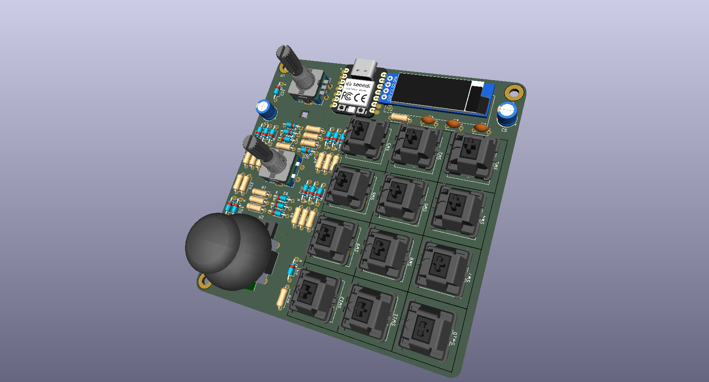
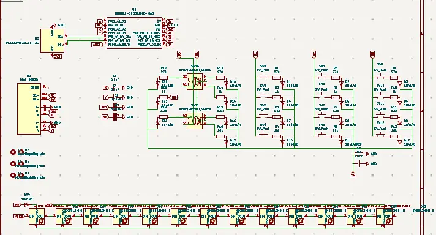
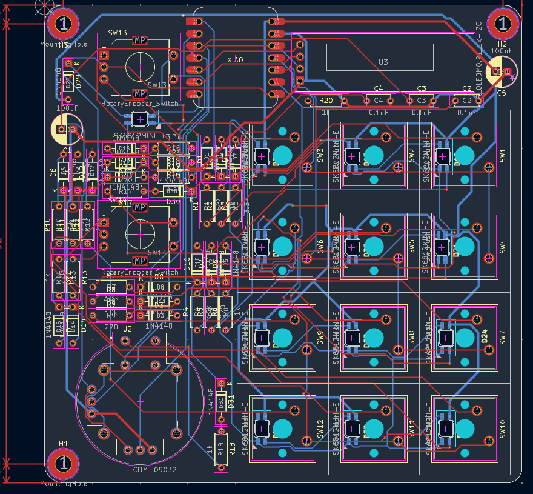
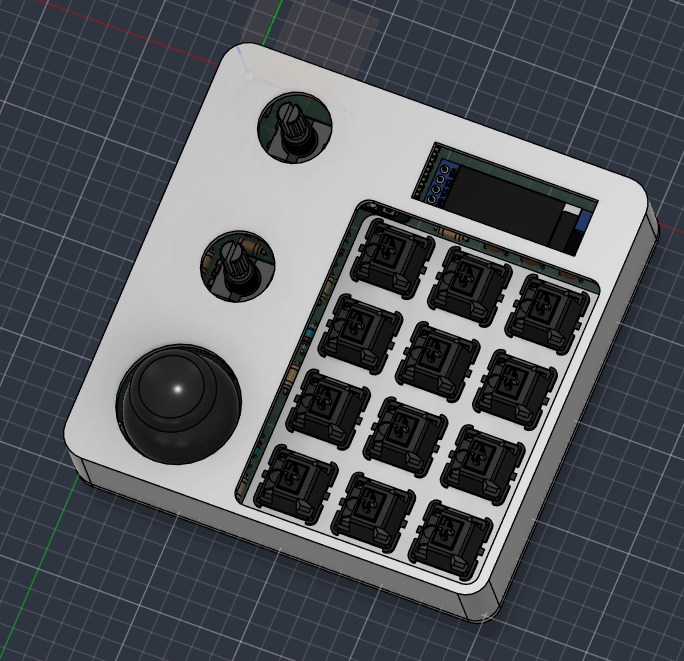
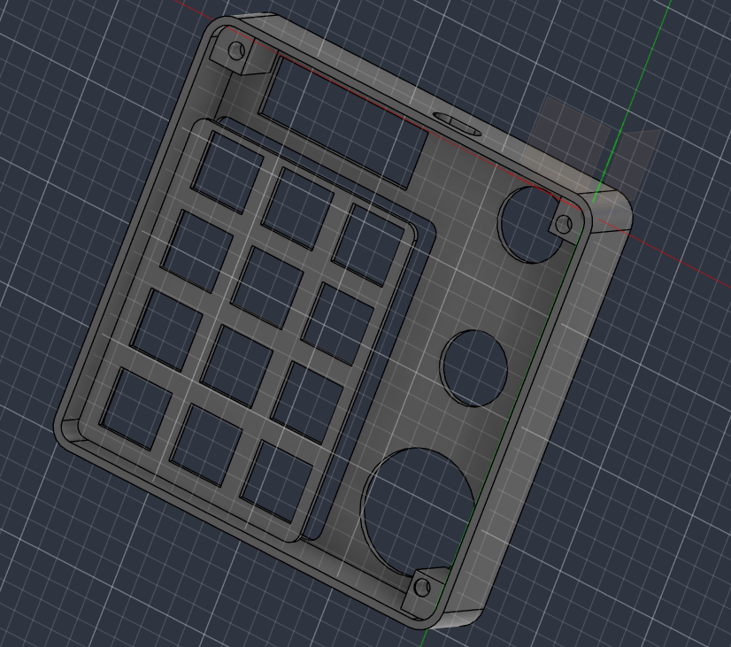

# Dialpad — Custom Macropad

A custom-designed macropad built around the **Seeed Studio XIAO RP2040**, featuring 12 mechanical keys, two rotary controls, a joystick, and a display. Designed with KiCad and Fusion 360, Dialpad brings everything a normal keyboard misses! even a joystick!
Specifically made to optimize cad designing experience and improve player control in video games.  

### Features

- **12 mechanical keys** for shortcuts and custom actions
- **Resistor ladder wiring method** allows multiple keys to share a single analog gpio
- **2 rotary controls** for adjustable parameters and navigation
- **1 joystick** for directional input
- **Display** for visual feedback
- **XIAO RP2040** as the main microcontroller
- Custom PCB designed in KiCad
- Custom enclosure designed in Fusion 360
- Custom micropython firmware with serial communicaiton

## Project Gallery

### 1. Complete Macropad




### 2. Schematic




### 3. PCB Layout

<!-- Add a screenshot of the PCB layout exported from KiCad. -->



### 4. Case Design and Assembly

<!-- Add a Fusion 360 screenshot showing the assembled case and how its parts fit together. -->




## Bill of Materials (BOM)

| Component | Quantity | Purpose |
|---|---:|---|
| Seeed Studio XIAO RP2040 | 1 | Main microcontroller |
| Mechanical key switches | 12 | Primary key inputs |
| Rotary encoders | 2 | Rotary input and adjustment |
| Joystick module | 1 | Directional input |
| Display module | 1 | Visual feedback |
| PCB | 1 | Main circuit board |
| Resistors | 17 | Input circuitry |
| Diodes | 17 | Input circuitry |
| USB cable | 1 | Power and USB connection |
| 3D-printed enclosure | 1 set | Protects and supports the electronics |
| Keycaps | 12 | Key tops |
| Knobs | 2 | Rotary encoder controls |
| Heatset brass inserts | 3 | Secures the PCB and enclosure |
| M3 Screws | 3 | Secures the PCB and enclosure |

## Repository Structure

```text
Dialpad/
├── CAD/
│   └── Complete case assembly (STEP/STP/3MF)
├── PCB/
│   ├── KiCad project file (.kicad_pro)
│   ├── Schematic file (.kicad_sch)
│   └── PCB layout file (.kicad_pcb)
├── Firmware/
│   └── Firmware source files
├── production/
│   ├── gerbers.zip
│   ├── Case manufacturing files (STEP/STL)
│   └── Firmware build (if applicable)
├── assets/
│   ├── pcb_layout.png
│   └── case_assembly.png
├── dialpad.png
├── Kicad_schematic_photo.png
└── README.md
```


## Design Tools

- **KiCad** — schematic capture and PCB design
- **Fusion 360** — enclosure design and CAD assembly
- **MicroPython** — firmware development, if using the current MicroPython implementation

## Project Status

- The PCB design, and the enclosure and firmware have been developed.
- Basic v1 firmware complete.
- Working on backend

## Acknowledgements

Created as part of the Hackpad project by Hack Club.

---

**Repository:** [parzival43/Dialpad](https://github.com/parzival43/Dialpad)
